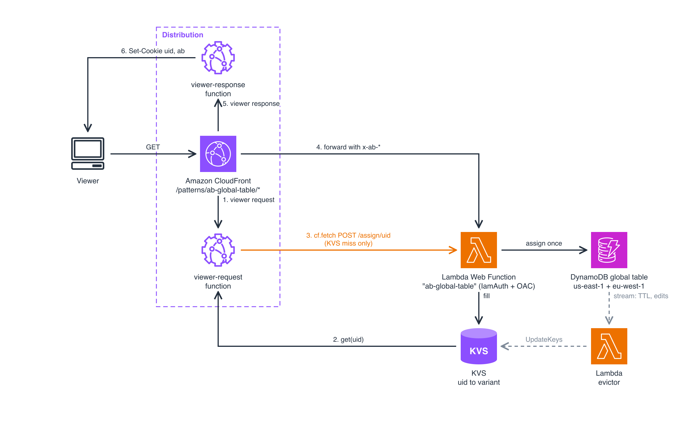
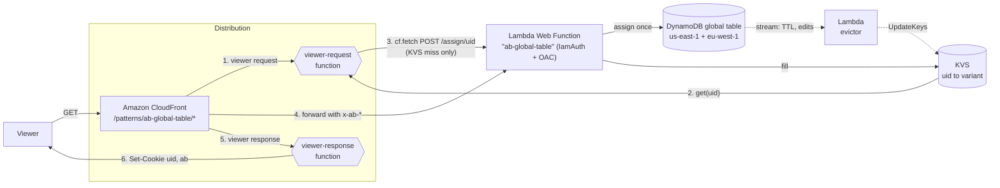
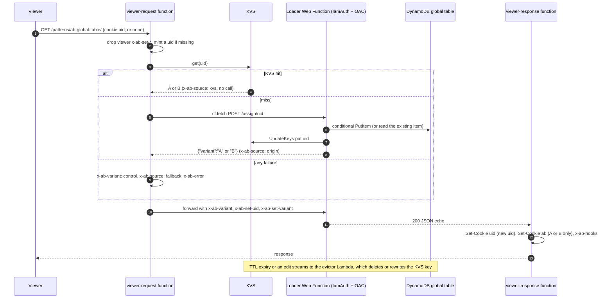

## Network call: sticky A/B variant, KeyValueStore first

**CloudFront Functions event types: viewer request (`index.js`) and viewer response (`response-function.js`)**

Each user gets an A/B variant once and keeps it. The request function names the user by a `uid` cookie (it issues one when there is none) and reads the user's variant from [CloudFront KeyValueStore](https://docs.aws.amazon.com/AmazonCloudFront/latest/DeveloperGuide/kvs-with-functions.html). Only a miss makes the one `cf.fetch` call, `POST /assign/<uid>` to an assignment service, which assigns the variant once in its own store. The function forwards the request with `x-ab-variant` (`A` or `B`) and `x-ab-source` (`kvs`, `origin` or `fallback`), and leaves the decision for the response function in `x-ab-set-uid` and `x-ab-set-variant`.

The response function makes no call. It turns those two headers into `uid` and `ab` cookies. Cookies set by the origin would be lost on a cache hit; a viewer response function runs on cache hits too, so stickiness survives the cache.

Why a network call: the assignment must be global and durable (overrides, re-bucketing, audit), so it lives in a database, not in a hash at the edge. KVS holds the warm working set, so a returning user costs no call.

A variant is not an access decision, so the function fails open: any failure forwards the request as `control`, with `x-ab-error`, and `control` never becomes a cookie, so the next visit tries again. The new `uid` is a SHA-256 of the request id, the viewer IP and the time: a function cannot make a network call after generating random values, so `Math.random()` is not an option. The function deletes every viewer-supplied `x-ab-*` header first, so a viewer cannot make the response function set a cookie of their choosing; the response function checks both values again.

### Architecture

The deployable version of this example ([patterns/04-ab-global-table](https://github.com/aws-samples/sample-cloudfront-functions-network-calls-patterns/tree/main/patterns/04-ab-global-table))
looks like this; this folder holds only the CloudFront Function code.





### Sequence diagram



### Requirements

- **Runtime** `cloudfront-js-2.0`. Network calls are not available with continuous deployment or the free pricing plan.
- **An origin on the same distribution** with the origin id `assigner` (the origin's **Name** in the console; change `ASSIGNER_ORIGIN_ID` at the top of `index.js` to use another). It can also be the content origin.
- **The origin contract**:

  | | |
  |---|---|
  | Request | `POST /assign/<uid>`, no body. `uid` is 16 lowercase hex characters. The viewer's own headers are not copied onto the call |
  | Answer | `200` with `{"variant": "A"}` or `{"variant": "B"}`. The same `uid` must always get the same variant: assign once (for example a conditional write), then return the stored one. At most 10 KB |
  | Time | The whole answer within 1 second. This is fixed by the runtime and cannot be changed; past it the request is forwarded as `control`. A cold backend that writes before it answers can miss this on its first request |

- **A store of assignments** behind the origin, the source of truth: for example an Amazon DynamoDB table (a global table if several Regions assign), keyed by `uid`, with a TTL if assignments should expire.
- **A job that writes KVS keys from the store**: for every assignment, the key `<uid>` (the 16 hex characters, no prefix) with the value `A` or `B`, and a delete when an assignment expires or is removed. With DynamoDB this is a Lambda function on the table's stream calling the KVS `UpdateKeys` API. Until a key reaches the edge (a KVS write takes up to about a minute), reads miss and make the call, which is harmless because the store answers the same variant. A KVS store holds up to 5 MB, about 300,000 users at 17 bytes each.
- **KeyValueStore**: associated with the request function. Without a KVS every request is a miss and makes the call.
- **Lock the origin** so that only CloudFront can call it. Any origin type works. For a Lambda Web Function, use an `IamAuth` endpoint behind origin access control (OAC) that signs with `always-amz-auth`: CloudFront signs the `POST` with an unsigned payload, so the function needs no body hash.
- **The cookies** are `Path=/; Max-Age=86400; Secure; HttpOnly; SameSite=Lax`. Change `COOKIE_ATTRIBUTES` in `response-function.js` to scope them.

### Deploy

[Create a KeyValueStore](https://docs.aws.amazon.com/AmazonCloudFront/latest/DeveloperGuide/kvs-with-functions-create.html) (it can start empty). Then follow [Deploying a CloudFront function using the AWS CLI](../README.md#deploying-a-cloudfront-function-using-the-aws-cli) in the root README, once for each function:

```
aws cloudfront create-function \
--name network-call-ab-sticky-variant \
--function-config '{"Comment":"Sticky A/B variant, KVS first","Runtime":"cloudfront-js-2.0","KeyValueStoreAssociations":{"Quantity":1,"Items":[{"KeyValueStoreARN":"arn:aws:cloudfront::XXXXXXXXXXXX:key-value-store/XXXXXXXX-XXXX-XXXX-XXXX-XXXXXXXXXXXX"}]}}' \
--function-code fileb://network-call-ab-sticky-variant/index.js

aws cloudfront create-function \
--name network-call-ab-sticky-cookies \
--function-config Comment="Set the A/B cookies",Runtime=cloudfront-js-2.0 \
--function-code fileb://network-call-ab-sticky-variant/response-function.js
```

Publish both with `aws cloudfront publish-function` and add them to the same cache behavior, the first with `"EventType": "viewer-request"` and the second with `"EventType": "viewer-response"`. If the variant changes the content, add `x-ab-variant` to the cache policy's cache key, so `A` and `B` are cached apart.

### How it fails

| What goes wrong | The viewer gets | Header on the forwarded request |
|---|---|---|
| No KVS, or no key for this `uid` | one call, then the assigned variant | `x-ab-kvs: miss: <reason>`, `x-ab-source: origin` |
| The assigner answers non-2xx | forwarded as `control`, no `ab` cookie | `x-ab-source: fallback`, `x-ab-error: Error: assigner returned <status>` |
| `TypeError`, `TimeoutError` (no full answer within 1 second), `InternalError`, a body that is not JSON, an unknown variant | forwarded as `control`, no `ab` cookie | `x-ab-source: fallback`, `x-ab-error: <name>: <message>` |
| The response function is not attached | no cookies; a new `uid` on every visit | |

A deployable version with the origin and infrastructure: https://github.com/aws-samples/sample-cloudfront-functions-network-calls-patterns/tree/main/patterns/04-ab-global-table/
