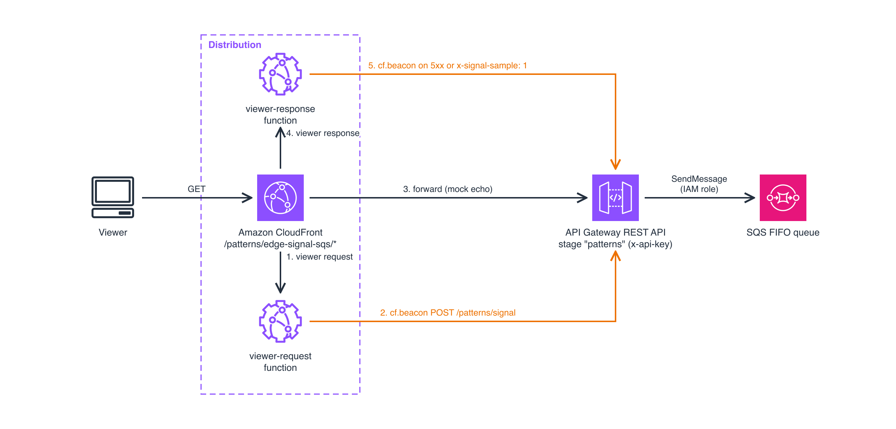
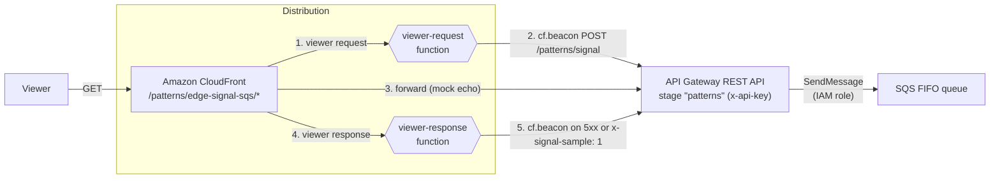
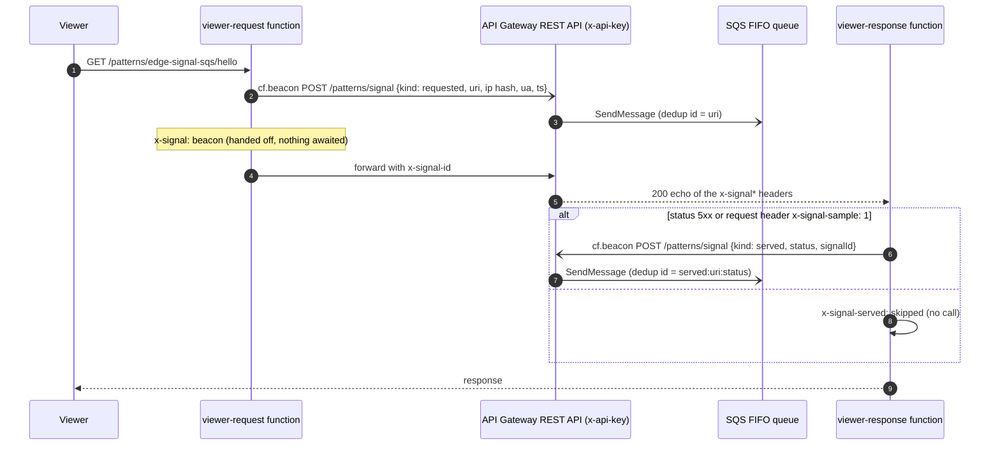

## Network call: fire-and-forget signal with `cf.beacon`

**CloudFront Functions event types: viewer request (`index.js`) and viewer response (`response-function.js`)**

These two functions send small JSON events to an event collector with `cf.beacon`, the fire-and-forget form of a network call. `cf.beacon` returns at once, with nothing to await and no answer to read, so the viewer never waits for the collector.

- `index.js` (viewer request) sends a `requested` event for every request: the URI, a truncated SHA-256 of the viewer IP (the raw IP never leaves the edge), the user agent (cut to 200 characters) and the time. It then forwards the request with `x-signal: beacon` and `x-signal-id` (the URI, used to correlate the two events).
- `response-function.js` (viewer response) sends a `served` event with the status code, but only for a sample of responses (`SAMPLE_PERCENT`, 1% by default). The viewer response event runs on cache hits too, so a call there must be rare by construction. The sample is picked from a hash of the request id: a function cannot make a network call after it has generated random values, so `Math.random()` is not an option.

Why a network call: request telemetry or audit events at the edge, sent to your own collector, without logging pipelines and without delaying the response. Losing an event is better than holding up the viewer, so both functions always forward.

The request function deletes viewer-supplied `x-signal`, `x-signal-id` and `x-signal-error` headers before it sets its own.

### Architecture

The deployable version of this example ([patterns/05-edge-signal-sqs](https://github.com/aws-samples/sample-cloudfront-functions-network-calls-patterns/tree/main/patterns/05-edge-signal-sqs))
looks like this; this folder holds only the CloudFront Function code.





### Sequence diagram



### Requirements

- **Runtime** `cloudfront-js-2.0`. Network calls are not available with continuous deployment or the free pricing plan. `cf.beacon` is the one network call of an invocation: a function that beacons cannot also call `cf.fetch`. The request and the response are two invocations, so each function gets its own call.
- **An origin on the same distribution** with the origin id `signal-collector` (the origin's **Name** in the console; change `SIGNAL_ORIGIN_ID` at the top of both files to use another). It does not need a cache behavior of its own.
- **The origin contract**:

  | | |
  |---|---|
  | Request | `POST /signal`, `content-type: application/json`. `requested` event: `{"kind": "requested", "uri": "/index.html", "ip": "<16 hex>", "ua": "...", "ts": <epoch ms>}`. `served` event: `{"kind": "served", "uri": "/index.html", "status": 200, "signalId": "/index.html", "dedupId": "served:/index.html:200", "ts": <epoch ms>}` |
  | Answer | Any `2xx`. The answer is never read |
  | Time | Within 1 second, fixed by the runtime. A slower collector does not delay the viewer; the event is lost and the failure is logged |

  One way to build the collector with no code: an Amazon API Gateway REST API with an Amazon SQS service integration (API Gateway signs `SendMessage`), with `uri` (or `dedupId`) as the FIFO deduplication id. If the API stage is the first path segment, set it as the origin path, or change `SIGNAL_PATH`.
- **Lock the origin** so that only CloudFront can call it. Any origin type works. For a Lambda Web Function, use an `IamAuth` endpoint behind origin access control (OAC) that signs with `always-amz-auth`. For an API Gateway REST API, require an API key and add it as an `x-api-key` custom origin header: it is sent on every beacon.

### Deploy

Follow [Deploying a CloudFront function using the AWS CLI](../README.md#deploying-a-cloudfront-function-using-the-aws-cli) in the root README, once for each function:

```
aws cloudfront create-function \
--name network-call-beacon-request \
--function-config Comment="Requested event with cf.beacon",Runtime=cloudfront-js-2.0 \
--function-code fileb://network-call-beacon-signal/index.js

aws cloudfront create-function \
--name network-call-beacon-response \
--function-config Comment="Sampled served event with cf.beacon",Runtime=cloudfront-js-2.0 \
--function-code fileb://network-call-beacon-signal/response-function.js
```

Publish both with `aws cloudfront publish-function` and add them to the same cache behavior, `network-call-beacon-request` with `"EventType": "viewer-request"` and `network-call-beacon-response` with `"EventType": "viewer-response"`. You can deploy either one alone.

Delivery failures after the function returned are written to the function's CloudWatch Logs (`logDeliveryErrors: true`); that is the only place to see them.

### How it fails

| What goes wrong | The viewer gets | Header |
|---|---|---|
| `cf.beacon` throws (a bad option, a second call) | forwarded | `x-signal: failed`, `x-signal-error` |
| Delivery fails after the function returned (collector unreachable or slow) | forwarded, `x-signal: beacon` | none; the failure is in CloudWatch Logs |
| The response-side beacon throws | the response | `x-signal-served: failed`, `x-signal-served-error` |
| The origin answers 400 or higher | the error | none: CloudFront does not run viewer response functions for those |

`x-signal: beacon` means handed off, not delivered. These headers are debug output: count events at the collector.

A deployable version with the origin and infrastructure: https://github.com/aws-samples/sample-cloudfront-functions-network-calls-patterns/tree/main/patterns/05-edge-signal-sqs/
