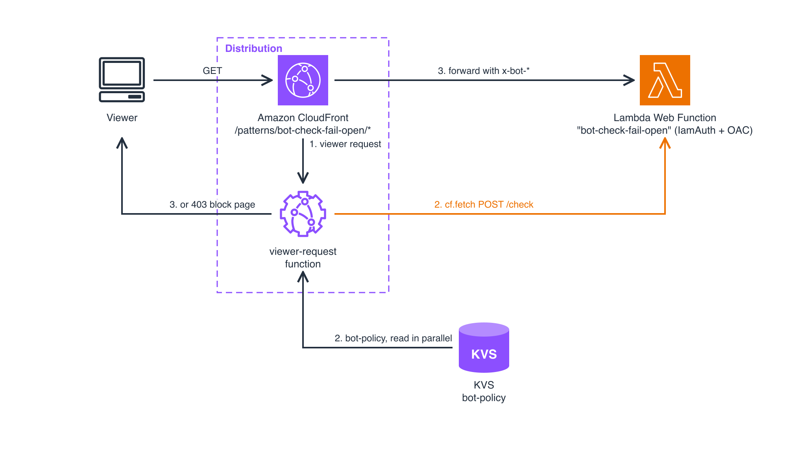
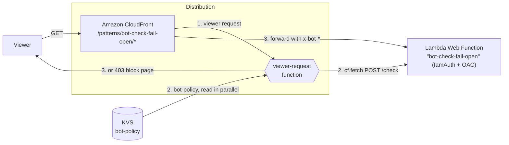
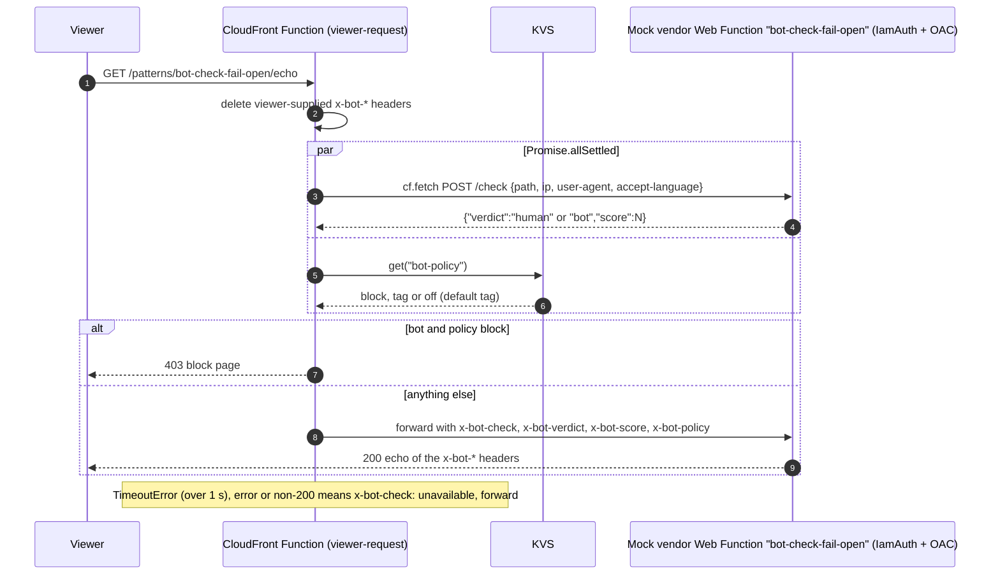

## Network call: bot check that fails open

**CloudFront Functions event type: viewer request**

This function asks a bot-detection service about every request with one `cf.fetch` call, and at the same time reads a policy (`block`, `tag` or `off`) from [CloudFront KeyValueStore](https://docs.aws.amazon.com/AmazonCloudFront/latest/DeveloperGuide/kvs-with-functions.html). A `bot` verdict with policy `block` gets a `403` page from the function. With `tag`, the request is forwarded with the verdict in `x-bot-verdict` and `x-bot-score`, and the origin decides. With `off`, the verdict is ignored.

Why a network call: the verdict comes from a service that sees more than one request (reputation data, a third-party vendor, a model), which a function cannot hold.

The check is a signal, not an authorization decision, so it fails open: if the service is slow or down, the request goes through with `x-bot-check: unavailable`. The function deletes every viewer-supplied `x-bot-*` header first, so a viewer cannot forge a verdict or a policy. The call and the KVS read run in parallel with `Promise.allSettled`, not `Promise.all`, so a missing KVS key does not throw away the verdict.

### Architecture

The deployable version of this example ([patterns/03-bot-check-fail-open](https://github.com/aws-samples/sample-cloudfront-functions-network-calls-patterns/tree/main/patterns/03-bot-check-fail-open))
looks like this; this folder holds only the CloudFront Function code.





### Sequence diagram



### Requirements

- **Runtime** `cloudfront-js-2.0`. Network calls are not available with continuous deployment or the free pricing plan.
- **An origin on the same distribution** with the origin id `bot-check` (the origin's **Name** in the console; change `VENDOR_ORIGIN_ID` at the top of `index.js` to use another). It does not need a cache behavior of its own.
- **The origin contract**:

  | | |
  |---|---|
  | Request | `POST /check`, `content-type: application/json`, body `{"path": "/index.html", "ip": "192.0.2.10", "userAgent": "...", "acceptLanguage": "..."}`. The viewer's own headers are not copied onto the call |
  | Answer | `200` with `{"verdict": "bot", "score": 90}` (`verdict` is `bot` or `human`). At most 10 KB |
  | Time | The whole answer within 1 second. This is fixed by the runtime and cannot be changed; past it the request is forwarded unchecked |

- **KeyValueStore (optional)**: the key `bot-policy` with the value `block`, `tag` or `off`. Without a KVS, without the key, or with any other value, the policy is `tag`, and `x-bot-policy-source` says why.
- **Lock the origin** so that only CloudFront can call it. Any origin type works. For a Lambda Web Function (`*.lambda-web.<region>.on.aws`), use an `IamAuth` endpoint behind origin access control (OAC) that signs with `always-amz-auth`: CloudFront signs the `POST` with an unsigned payload, so the function needs no body hash. For a Lambda function URL origin behind OAC, the function must send an `x-amz-content-sha256` header with the SHA-256 of the body. For a third-party vendor, put the vendor's API key in a custom origin header on that origin: it is sent on the call.

### Deploy

[Create a KeyValueStore](https://docs.aws.amazon.com/AmazonCloudFront/latest/DeveloperGuide/kvs-with-functions-create.html) with the key `bot-policy` if you want to switch the policy without a new function version. Then follow [Deploying a CloudFront function using the AWS CLI](../README.md#deploying-a-cloudfront-function-using-the-aws-cli) in the root README, with these values:

```
aws cloudfront create-function \
--name network-call-bot-check-fail-open \
--function-config '{"Comment":"Bot check that fails open","Runtime":"cloudfront-js-2.0","KeyValueStoreAssociations":{"Quantity":1,"Items":[{"KeyValueStoreARN":"arn:aws:cloudfront::XXXXXXXXXXXX:key-value-store/XXXXXXXX-XXXX-XXXX-XXXX-XXXXXXXXXXXX"}]}}' \
--function-code fileb://network-call-bot-check-fail-open/index.js
```

Leave out `KeyValueStoreAssociations` to run without a KVS. Then publish it with `aws cloudfront publish-function` and add it to a cache behavior, with `"EventType": "viewer-request"`.

### How it fails

| What goes wrong | The viewer gets | Header on the forwarded request |
|---|---|---|
| The service answers non-2xx | forwarded, no verdict | `x-bot-check: unavailable`, `x-bot-check-error: Error: vendor returned <status>` |
| `TimeoutError` (no full answer within 1 second) | forwarded, no verdict | `x-bot-check: unavailable`, `x-bot-check-error: TimeoutError: ...` |
| `TypeError`, `InternalError`, a body that is not JSON, an unknown verdict | forwarded, no verdict | `x-bot-check: unavailable`, `x-bot-check-error` |
| No KVS, no `bot-policy` key, or an unknown value | policy `tag` | `x-bot-policy-source: default: <name>: <message>` |

A deployable version with the origin and infrastructure: https://github.com/aws-samples/sample-cloudfront-functions-network-calls-patterns/tree/main/patterns/03-bot-check-fail-open/
