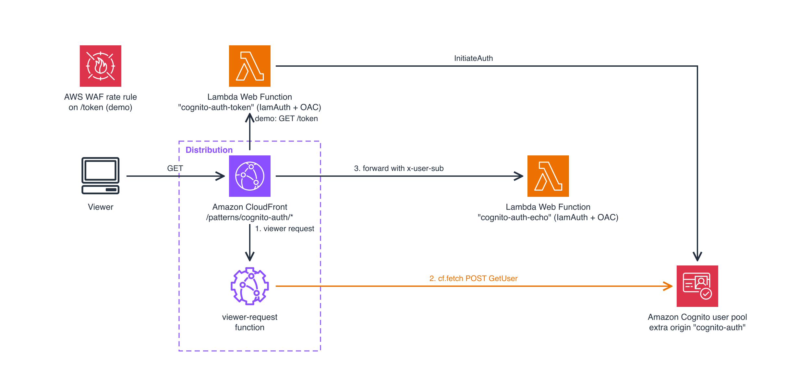
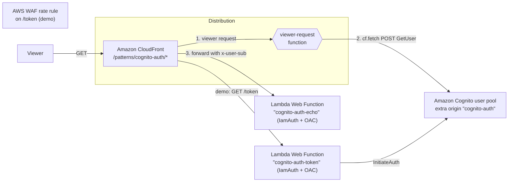
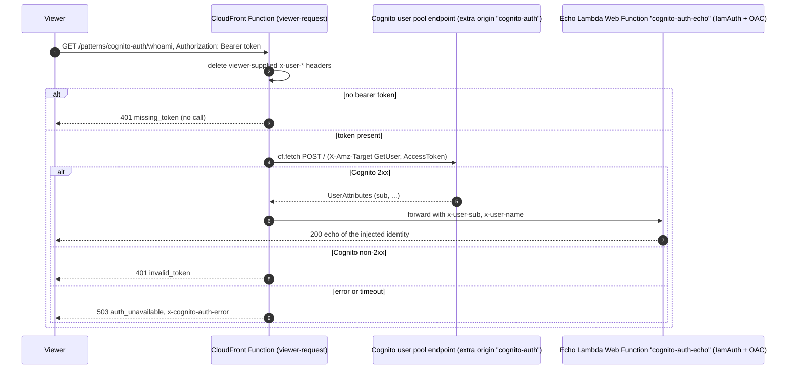

## Network call: Amazon Cognito access token check

**CloudFront Functions event type: viewer request**

This function sends the viewer's bearer token to the [Amazon Cognito](https://docs.aws.amazon.com/cognito/latest/developerguide/cognito-user-pools.html) `GetUser` API with one `cf.fetch` call, and forwards the request with `x-user-sub` and `x-user-name` set from the answer. `GetUser` is authenticated by the access token itself, so the function holds no credentials and needs no SigV4 signature and no JWT library.

Why a network call: Cognito knows whether a token is still valid right now (a signed-out user, a deleted user, a revoked token), which a signature check at the edge cannot tell.

A request with no `Authorization: Bearer` header is answered `401` by the function, before any call. The function fails closed: no verified identity, no request to the origin, and a Cognito that cannot be asked gives `503`. It deletes every viewer-supplied `x-user-*` header first, so a viewer cannot forge an identity. All denials carry `cache-control: no-store`.

### Architecture

The deployable version of this example ([patterns/01-cognito-auth](https://github.com/aws-samples/sample-cloudfront-functions-network-calls-patterns/tree/main/patterns/01-cognito-auth))
looks like this; this folder holds only the CloudFront Function code.





### Sequence diagram



### Requirements

- **Runtime** `cloudfront-js-2.0`. Network calls are not available with continuous deployment or the free pricing plan.
- **An Amazon Cognito user pool** whose app client issues access tokens to your users. `GetUser` needs an access token with the `aws.cognito.signin.user.admin` scope, which tokens from the Cognito user pools API (`InitiateAuth`) carry. With the managed login (hosted UI), request that scope.
- **The pool's regional endpoint as an origin on the same distribution**: a custom origin with the domain `cognito-idp.<Region>.amazonaws.com` (the Region of the user pool), protocol `HTTPS only`, and the origin id `cognito` (the origin's **Name** in the console; change `COGNITO_ORIGIN_ID` at the top of `index.js` to use another). It needs no cache behavior: only the function calls it.
- **The origin contract**, which is the Cognito API:

  | | |
  |---|---|
  | Request | `POST /`, `content-type: application/x-amz-json-1.1`, `x-amz-target: AWSCognitoIdentityProviderService.GetUser`, body `{"AccessToken": "<token>"}`. The viewer's own headers are not copied onto the call |
  | Answer | `200` with `{"Username": "...", "UserAttributes": [{"Name": "sub", "Value": "..."}, ...]}`. `400` (`NotAuthorizedException`) for a bad, expired or revoked token |
  | Time | The whole answer within 1 second. This is fixed by the runtime and cannot be changed; past it the viewer gets `503` |

- **The origin needs no lock**: it is the public Cognito endpoint, and the token in the body is the credential.
- **The content origin** behind the cache behavior trusts `x-user-sub` and `x-user-name` only from CloudFront. Lock it so that viewers cannot reach it directly (for example with origin access control).
- `GetUser` counts against a Cognito API quota. For high request rates, cache verdicts, for example with [the KVS read-through example](../network-call-kvs-config-read-through/).

### Deploy

Follow [Deploying a CloudFront function using the AWS CLI](../README.md#deploying-a-cloudfront-function-using-the-aws-cli) in the root README, with these values:

```
aws cloudfront create-function \
--name network-call-cognito-auth \
--function-config Comment="Cognito access token check",Runtime=cloudfront-js-2.0 \
--function-code fileb://network-call-cognito-auth/index.js
```

Then publish it with `aws cloudfront publish-function` and add it to the cache behavior you want to protect, with `"EventType": "viewer-request"`.

### How it fails

| What goes wrong | The viewer gets | Header |
|---|---|---|
| No bearer token | `401`, `{"error":"missing_token"}`; no call | `www-authenticate: Bearer` |
| Cognito rejects the token (non-2xx) | `401`, `{"error":"invalid_token"}` | `www-authenticate: Bearer` |
| Cognito answers without a `sub` attribute | `401`, `{"error":"invalid_token"}` | `www-authenticate: Bearer` |
| `TypeError`, `TimeoutError` (no full answer within 1 second), `InternalError`, or a body that is not JSON | `503`, `{"error":"auth_unavailable"}` | `x-cognito-auth-error: <name>: <message>` |

A deployable version with the origin and infrastructure: https://github.com/aws-samples/sample-cloudfront-functions-network-calls-patterns/tree/main/patterns/01-cognito-auth/
