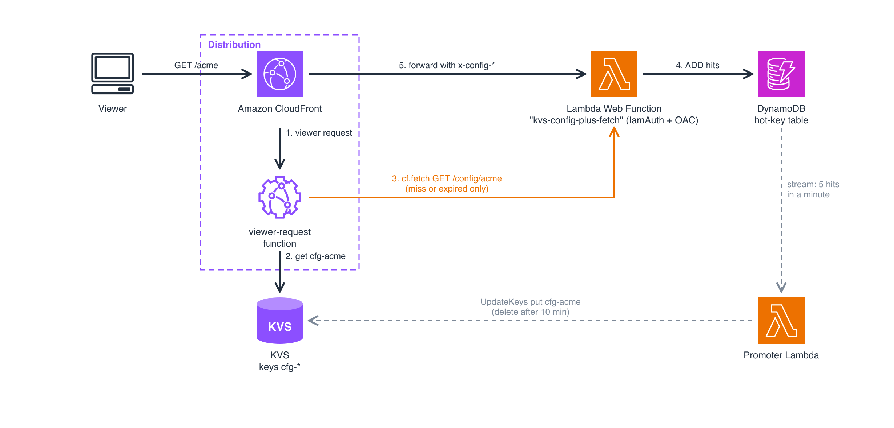
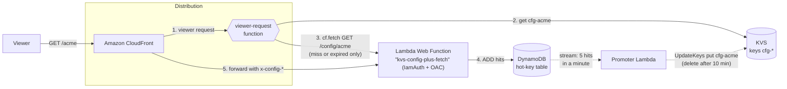

## Network call: KeyValueStore read-through config

**CloudFront Functions event type: viewer request**

This function finds the config that applies to a key (a tenant's plan, a model route, a rate limit) and forwards it to the origin in `x-config`, with `x-config-key` and `x-config-source`. The key is the first path segment: `/acme/orders` reads the config of `acme`, and `/` reads `default`. It reads [CloudFront KeyValueStore](https://docs.aws.amazon.com/AmazonCloudFront/latest/DeveloperGuide/kvs-with-functions.html) first: a fresh entry needs no call. A missing or expired entry makes the one `cf.fetch` call, `GET /config/<key>`, to a config service that also counts the read.

Why a network call: KVS holds at most 5 MB and is written from outside, so it cannot hold every key or learn about a new one on its own. Reading through to the config service serves the long tail, and the count tells a job off the request path which keys are hot. That job writes hot keys to KVS, so the busiest keys cost no call. The function never writes KVS itself.

The KVS value carries its own expiry. An expired entry is read through again, which is how a hot key picks up a changed config. If that call fails, the expired value still beats the default. Config is not an access decision here, so the function fails open: the expired KVS entry, else `DEFAULT_CONFIG` (the lowest tier), and the request is always forwarded. If your config grants access, decide whether the default should deny instead. A key outside `a-z`, `0-9`, `-`, 1-32 characters gets `400` with no call. The function deletes viewer-supplied `x-config`, `x-config-key`, `x-config-source`, `x-config-hits` and `x-config-error` headers first.

### Architecture

The deployable version of this example ([patterns/07-kvs-config-plus-fetch](https://github.com/aws-samples/sample-cloudfront-functions-network-calls-patterns/tree/main/patterns/07-kvs-config-plus-fetch))
looks like this; this folder holds only the CloudFront Function code.





### Sequence diagram

```mermaid
sequenceDiagram
  autonumber
  participant V as Viewer
  participant F as CloudFront Function (viewer-request)
  participant K as KVS
  participant L as Config Web Function "kvs-config-plus-fetch" (IamAuth + OAC)
  participant D as DynamoDB hot-key table
  participant P as Promoter Lambda
  V->>F: GET /patterns/kvs-config-plus-fetch/acme
  F->>F: drop viewer x-config-*
  F->>K: get("cfg-acme")
  alt fresh entry
    K-->>F: {"exp":...,"config":{...}} (x-config-source: kvs, no call)
  else miss or expired
    F->>L: cf.fetch GET /config/acme
    L->>D: ADD hits on hits#35;acme#35;<minute>
    L-->>F: {"config":{...},"hits":3,"threshold":5} (x-config-source: origin)
  else call fails
    F->>F: expired entry (kvs-stale), else DEFAULT_CONFIG (default), x-config-error
  end
  F->>L: forward with x-config, x-config-key, x-config-source
  L-->>V: 200 JSON echo of the x-config-* headers
  Note over D,P: off the request path, from the table's stream
  D-->>P: counter reached 5
  P->>D: put marker kvs#35;acme (TTL = now + 10 min)
  D-->>P: marker written
  P->>K: UpdateKeys put cfg-acme (reaches the edge in about a minute)
  D-->>P: marker removed by TTL
  P->>K: UpdateKeys delete cfg-acme
```



### Requirements

- **Runtime** `cloudfront-js-2.0`. Network calls are not available with continuous deployment or the free pricing plan.
- **An origin on the same distribution** with the origin id `config` (the origin's **Name** in the console; change `CONFIG_ORIGIN_ID` at the top of `index.js` to use another). It needs no cache behavior: make sure viewers cannot reach `/config/<key>`.
- **The origin contract**:

  | | |
  |---|---|
  | Request | `GET /config/<key>`, no body. The viewer's own headers are not copied onto the call |
  | Answer | `200` with `{"config": {"plan": "enterprise", "model": "large", "rateLimit": 1000}, "hits": 3, "threshold": 5}`. `config` is required and forwarded as JSON in `x-config`; `hits` and `threshold` are optional and forwarded as `x-config-hits: 3/5`. At most 10 KB |
  | Time | The whole answer within 1 second. This is fixed by the runtime and cannot be changed; past it the request gets the stale or default config |

- **A read counter** behind the origin: every `/config/<key>` read counts against the key in a time window, for example an Amazon DynamoDB item per key per minute updated with `ADD hits 1`, so the count is exact across instances.
- **A promoter that writes hot keys to KVS**: when a key's count reaches the threshold in one window, it writes the KVS key `cfg-<key>` with the value `{"exp": <epoch seconds>, "config": {...}}`, and deletes the key once the entry is cold. With DynamoDB this is a Lambda function on the table's stream calling the KVS `UpdateKeys` API. A KVS value is at most 1 KB, so a larger config stays a call. A KVS write takes up to about a minute to reach the edge; until then reads keep calling the origin.
- **KeyValueStore**: associated with the function. Without a KVS every request is a miss and makes the call.
- **Lock the origin** so that only CloudFront can call it. Any origin type works. For a Lambda Web Function, use an `IamAuth` endpoint behind origin access control (OAC) that signs with `always-amz-auth`.

### Deploy

[Create a KeyValueStore](https://docs.aws.amazon.com/AmazonCloudFront/latest/DeveloperGuide/kvs-with-functions-create.html) (it can start empty: the promoter fills it). Then follow [Deploying a CloudFront function using the AWS CLI](../README.md#deploying-a-cloudfront-function-using-the-aws-cli) in the root README, with these values:

```
aws cloudfront create-function \
--name network-call-kvs-config-read-through \
--function-config '{"Comment":"KVS read-through config","Runtime":"cloudfront-js-2.0","KeyValueStoreAssociations":{"Quantity":1,"Items":[{"KeyValueStoreARN":"arn:aws:cloudfront::XXXXXXXXXXXX:key-value-store/XXXXXXXX-XXXX-XXXX-XXXX-XXXXXXXXXXXX"}]}}' \
--function-code fileb://network-call-kvs-config-read-through/index.js
```

Then publish it with `aws cloudfront publish-function` and add it to a cache behavior, with `"EventType": "viewer-request"`.

### How it fails

| What goes wrong | The viewer gets | Header on the forwarded request |
|---|---|---|
| No KVS, no `cfg-<key>`, a value that is not JSON, or an expired entry | one call, then the origin's config | `x-config-source: origin` |
| The origin answers non-2xx, a body that is not JSON, or no `config` | forwarded with the expired KVS config, else `DEFAULT_CONFIG` | `x-config-source: kvs-stale` or `default`, `x-config-error` |
| `TypeError`, `TimeoutError` (no full answer within 1 second), `InternalError` | the same | `x-config-error: <name>: <message>` |
| The promoter or its KVS write fails | nothing changes for the viewer: the key stays a miss and a call | |
| A key outside `a-z`, `0-9`, `-`, 1-32 characters | `400` from the function, no call | |

A deployable version with the origin and infrastructure: https://github.com/aws-samples/sample-cloudfront-functions-network-calls-patterns/tree/main/patterns/07-kvs-config-plus-fetch/
