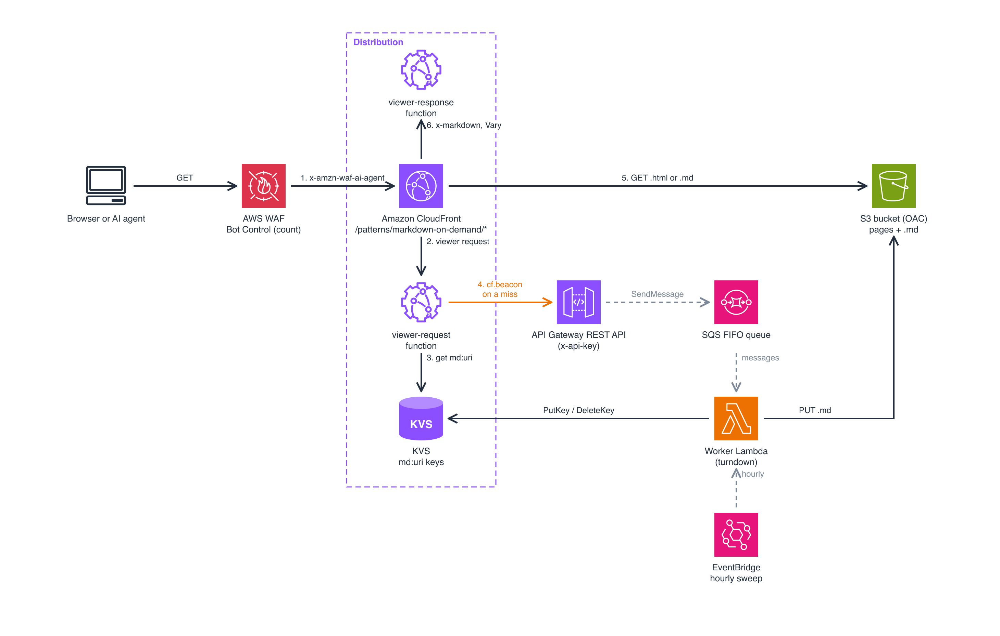
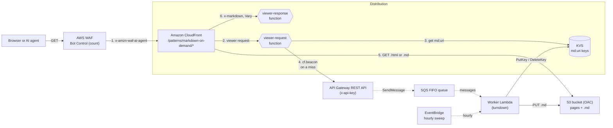
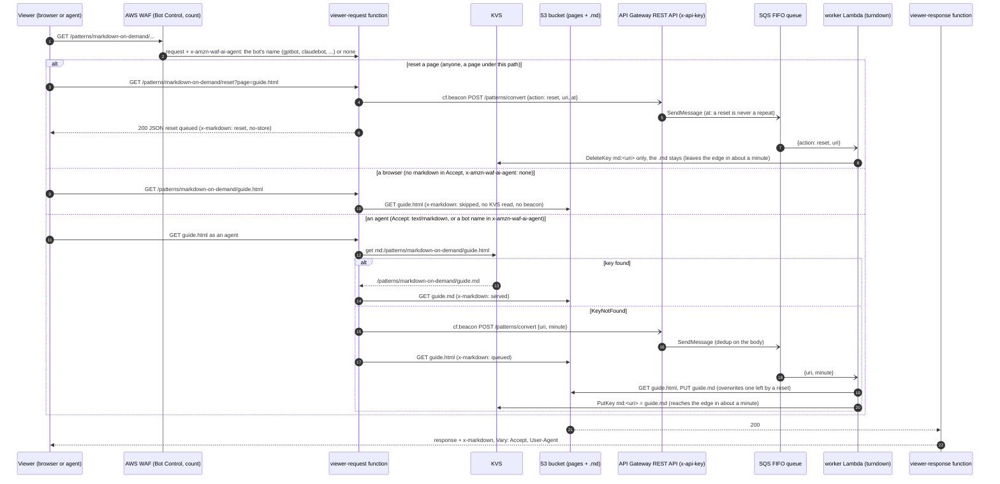

## Network call: markdown for AI agents, made on demand

**CloudFront Functions event types: viewer request (`index.js`) and viewer response (`response-function.js`)**

Agents read text, not layout, and a markdown copy of a page costs them far fewer tokens than the HTML. The request function spots an agent (`Accept: text/markdown`, or an AI bot that AWS WAF Bot Control labelled) and looks up `md:<uri>` in [CloudFront KeyValueStore](https://docs.aws.amazon.com/AmazonCloudFront/latest/DeveloperGuide/kvs-with-functions.html). A hit rewrites the URI to the `.md` object, with no call. A miss serves the HTML as usual and sends one `cf.beacon`, the fire-and-forget form of a network call, with the page URI to a queue. A worker converts the page offline and writes the `.md` and the KVS key, so the next agent gets markdown.

Why a network call: converting a page takes far longer than a function may run, so the function only asks for it, and the agent never waits. Only the pages agents actually ask for are converted. The KVS read answers "does markdown exist yet" without spending the one call of the invocation.

Markdown is an optimization, not a gate, so both functions fail open: a failed KVS read, a failed or dropped beacon, or a failed worker still serves the HTML. The beacon body is `{"uri": ..., "minute": ...}`: a FIFO queue with content-based deduplication turns a burst of agents asking for the same page within a minute into one message. Only `.html` pages with no other dots in the URI beacon, and a folder means its `index.html`. The request function deletes viewer-supplied `x-markdown` and `x-markdown-error` headers first.

The response function makes no call. It copies the request function's verdict onto the response (an S3 origin echoes nothing) and adds `Vary: Accept, User-Agent`, because the same URL answers HTML or markdown.

### Architecture

The deployable version of this example ([patterns/10-markdown-on-demand](https://github.com/aws-samples/sample-cloudfront-functions-network-calls-patterns/tree/main/patterns/10-markdown-on-demand))
looks like this; this folder holds only the CloudFront Function code.
The `/reset` steps are a demo endpoint of the deployable version; this example has no reset.





### Sequence diagram



### Requirements

- **Runtime** `cloudfront-js-2.0`. Network calls are not available with continuous deployment or the free pricing plan. `cf.beacon` is the one network call of the invocation.
- **The pages origin**: the cache behavior's origin serves the pages and the `.md` copies next to them, for example an Amazon S3 bucket behind origin access control (OAC).
- **A queue API on the same distribution** with the origin id `markdown-queue` (the origin's **Name** in the console; change `QUEUE_ORIGIN_ID` at the top of `index.js` to use another). It needs no cache behavior of its own. Two ways to build it, both fine:
  - **Simply, with no code:** an Amazon API Gateway REST API with an Amazon SQS service integration that sends the body to
    a FIFO queue with content-based deduplication. If the API stage is the first path segment, set it as the origin
    path, or change `CONVERT_PATH`. Nothing runs between the beacon and the queue.
  - **Globally, with a Lambda Web Function:** a small HTTP server that validates the job and sends it to the queue. Use it
    when you need logic before the queue, or one endpoint served from several Regions (a `MultiRegion` endpoint).
- **The origin contract**:

  | | |
  |---|---|
  | Request | `POST /convert`, `content-type: application/json`, body `{"uri": "/docs/guide.html", "minute": 29884320}` (`minute` is epoch minutes) |
  | Answer | Any `2xx`. The answer is never read |
  | Time | Within 1 second, fixed by the runtime. A slower API does not delay the viewer; the message is lost and the failure is logged (`logDeliveryErrors`), and the next agent request beacons again |

- **A worker behind the queue**, for example an AWS Lambda function on the SQS queue. For each message it reads the page (from the bucket, not through the distribution, so it never triggers itself), converts it to markdown, writes the `.md` next to the page (`/docs/guide.html` to `/docs/guide.md`), and then writes the KVS key `md:<page uri>` with the `.md` object's URI as the value: `md:/docs/guide.html` = `/docs/guide.md`. It writes the key only after the object, and accepts only the URIs the function's `PAGE` pattern accepts, so a message can never name another object. A KVS write takes up to about a minute to reach the edge; until then agents get the HTML and beacon again.
- **KeyValueStore**: associated with the request function. Without a KVS every agent request beacons and gets the HTML.
- **AWS WAF (optional)**: a web ACL with Bot Control (in count mode, so it labels and never blocks) and two count rules on these paths that insert a request header `ai-agent`: `none` on every request, then `${awswaf:managed:aws:bot-control:bot:name:}` on requests with the label `awswaf:managed:aws:bot-control:bot:category:ai` ([dynamic label interpolation](https://aws.amazon.com/blogs/security/do-more-with-aws-waf-labels-using-dynamic-label-interpolation/)). WAF prefixes inserted headers, so the function reads `x-amzn-waf-ai-agent`. The first rule overwrites any viewer copy; the function trusts the header only because of it. Without the web ACL, use `Accept: text/markdown` alone, or a viewer can claim to be an agent (which only gets them the same public content as markdown).
- **Lock the queue API** so that only CloudFront can call it. For an API Gateway REST API, require an API key and add it as an `x-api-key` custom origin header: it is sent on every beacon. For a Lambda Web Function, use an `IamAuth` endpoint behind origin access control (OAC) that signs with `always-amz-auth` (a global `MultiRegion` endpoint signs with SigV4a).
- **Caching**: if the behavior caches, put the agent signal in the cache key (for example a normalized `Accept` header), or a cached HTML copy is served to agents.
- **Stale markdown**: the `.md` is made once. When a page changes, have your publish pipeline delete its `md:<uri>` key, so the next agent request queues it again.

### Deploy

[Create a KeyValueStore](https://docs.aws.amazon.com/AmazonCloudFront/latest/DeveloperGuide/kvs-with-functions-create.html) (it can start empty: the worker fills it). Then follow [Deploying a CloudFront function using the AWS CLI](../README.md#deploying-a-cloudfront-function-using-the-aws-cli) in the root README, once for each function:

```
aws cloudfront create-function \
--name network-call-markdown-on-demand \
--function-config '{"Comment":"Markdown for agents, made on demand","Runtime":"cloudfront-js-2.0","KeyValueStoreAssociations":{"Quantity":1,"Items":[{"KeyValueStoreARN":"arn:aws:cloudfront::XXXXXXXXXXXX:key-value-store/XXXXXXXX-XXXX-XXXX-XXXX-XXXXXXXXXXXX"}]}}' \
--function-code fileb://network-call-markdown-on-demand/index.js

aws cloudfront create-function \
--name network-call-markdown-verdict \
--function-config Comment="Copy the markdown verdict, add Vary",Runtime=cloudfront-js-2.0 \
--function-code fileb://network-call-markdown-on-demand/response-function.js
```

Publish both with `aws cloudfront publish-function` and add them to the pages' cache behavior, the first with `"EventType": "viewer-request"` and the second with `"EventType": "viewer-response"`.

### How it fails

| What goes wrong | The viewer gets | Header |
|---|---|---|
| Not an agent, or not a page | the object as usual, no call | `x-markdown: skipped` |
| `cf.beacon` throws (an invalid call) | the HTML | `x-markdown: failed`, `x-markdown-error` |
| The beacon is lost after the function returned | the HTML | `x-markdown: queued`; the failure is in CloudWatch Logs. The next agent request beacons again |
| The worker fails | the HTML, meanwhile | `x-markdown: queued`; the queue retries the message |
| The KVS key has not reached this edge location yet | the HTML | `x-markdown: queued` again, deduplicated within the minute |
| The page does not exist | the origin's error (`403` from S3 behind OAC) | none: the viewer response function does not run on 400 or higher. The beacon was still sent; the worker drops the message |
| The `.md` was deleted but `md:<uri>` was not | the origin's error | none; delete the key too |

A deployable version with the origin and infrastructure: https://github.com/aws-samples/sample-cloudfront-functions-network-calls-patterns/tree/main/patterns/10-markdown-on-demand/
