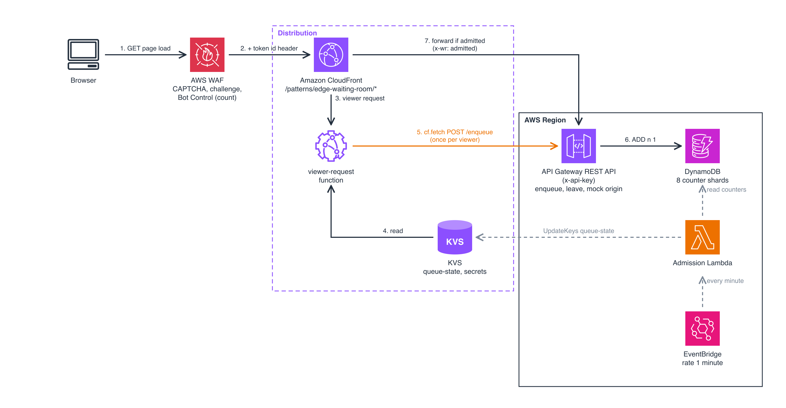
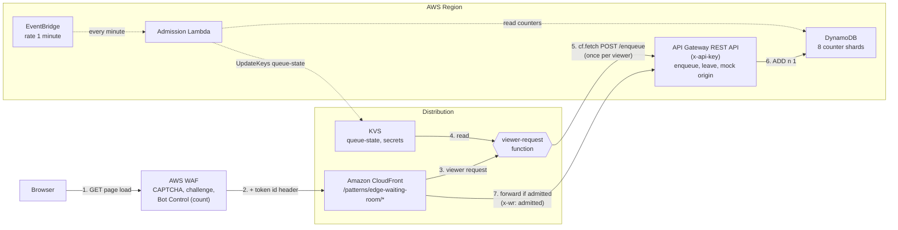
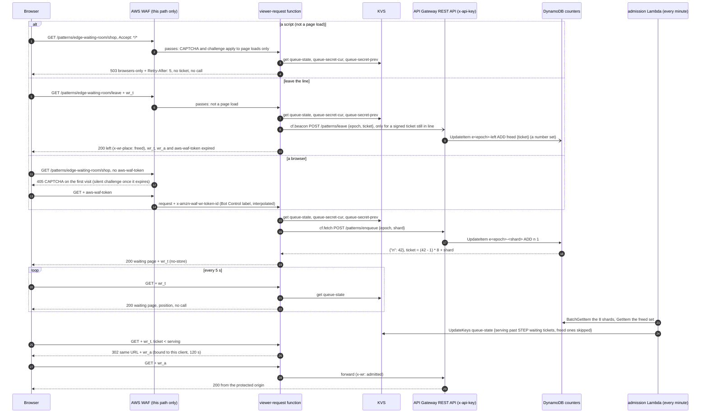

## Network call: virtual waiting room

**CloudFront Functions event type: viewer request**

A launch spike needs somewhere to wait that is not your origin. In this waiting room the queue is two integers: a **ticket counter** behind an origin, and a **watermark** (`serving`) in [CloudFront KeyValueStore](https://docs.aws.amazon.com/AmazonCloudFront/latest/DeveloperGuide/kvs-with-functions.html). A new browser spends the function's one network call to draw a ticket, `POST /enqueue`. The ticket travels in a signed cookie (`wr_t`, an HS256 JWT), so every refresh after that is a KVS read and a compare, with no call. An admission job raises the watermark by the number of viewers the origin can take per tick. A ticket below the watermark gets a short-lived pass (`wr_a`, bound to the client) and reaches the origin with `x-wr: admitted`.

Why a network call: a position in line needs one shared, atomic counter across every edge location, which a function and KVS cannot provide. The call is spent once per viewer, never per refresh.

AWS WAF is part of the design: it guards the ticket counter. A browser's first page load gets one CAPTCHA, and after that WAF's silent JavaScript challenge, so a script cannot draw tickets and fill the line. Only a browser page load (`GET` with `Accept: text/html`) without a valid cookie draws a ticket; anything else gets `503` with `Retry-After` and no ticket.

The function fails **closed**: the call is the protection, so when the counter cannot be reached, or there is no `queue-state` or secret yet, the viewer gets a waiting page and nothing reaches the origin. Only `mode: off`, an operator's choice, forwards without checks. Every answer from the function is `cache-control: no-store`. The shard of the counter is picked from a hash of the request id, not `Math.random()`, because a function cannot make a network call after generating random values. The function deletes viewer-supplied `x-wr` headers. `GET /leave` (the waiting page links to it) clears the cookies and frees a signed ticket that is still in line with one `cf.beacon`.

### Architecture

The deployable version of this example ([patterns/11-edge-waiting-room](https://github.com/aws-samples/sample-cloudfront-functions-network-calls-patterns/tree/main/patterns/11-edge-waiting-room))
looks like this; this folder holds only the CloudFront Function code.





### Sequence diagram



### Requirements

- **Runtime** `cloudfront-js-2.0`. Network calls are not available with continuous deployment or the free pricing plan.
- **A ticket counter API on the same distribution** with the origin id `waiting-room` (the origin's **Name** in the console; change `QUEUE_ORIGIN_ID` at the top of `index.js` to use another). It needs no cache behavior of its own. One way to build it with no code: an Amazon API Gateway REST API with Amazon DynamoDB service integrations (API Gateway holds the IAM role; the function holds no credentials). Shard the counter (`SHARDS`, 8 items) so one item's write limit does not cap the spike. If the API stage is the first path segment, set it as the origin path, or change `ENQUEUE_PATH` and `LEAVE_PATH`.
- **The origin contract**:

  | | |
  |---|---|
  | Draw a ticket | `POST /enqueue`, `content-type: application/json`, body `{"epoch": 1, "shard": 3}`. Atomically add 1 to the counter item of that epoch and shard (`UpdateItem ADD n 1` on `e<epoch>-<shard>`) and answer `200` with `{"n": <new value>}`. The ticket is `(n - 1) * 8 + shard`. Throttle the API below the counter's write capacity: a `429` is a waiting page that retries |
  | Leave | `POST /leave`, body `{"epoch": 1, "ticket": 42}`, sent with `cf.beacon`. Add the ticket to a set of freed tickets for that epoch (a set, so a replayed cookie frees one place). The answer is never read |
  | Time | The whole answer within 1 second. This is fixed by the runtime and cannot be changed; past it the viewer gets a waiting page that retries |

- **An admission job** that runs every tick (for example an AWS Lambda function on an Amazon EventBridge schedule, once a minute). It sums the counter shards, moves `serving` past `step` tickets that are still waiting (skipping freed ones, and never past the tickets drawn), and publishes to KVS:
  - `queue-state`, JSON: `{"mode": "on", "epoch": 1, "serving": 35, "step": 5, "tick": <epoch milliseconds>}`. `mode` `off` forwards everything; a new `epoch` starts a new line and voids old tickets; `tick` older than 5 minutes shows "The queue is paused".
  - `queue-secret-cur`, the HMAC secret that signs new cookies, and `queue-secret-prev`, which still verifies. To rotate, copy `cur` to `prev`, then write a new `cur`.
- **KeyValueStore**: associated with the function. Without `queue-state` or a secret, every viewer sees "The queue is starting".
- **AWS WAF in front**, on the protected paths: a web ACL with Bot Control (common level, **count**, so it labels and never blocks) and, in this order, a **CAPTCHA** rule for page loads whose token label is `awswaf:managed:captcha:absent` or `awswaf:managed:captcha:rejected:not_solved`, a **Challenge** rule for page loads (`Accept: text/html`), and a **count** rule that inserts the header `wr-token-id: ${awswaf:managed:token:id:}` ([dynamic label interpolation](https://aws.amazon.com/blogs/security/do-more-with-aws-waf-labels-using-dynamic-label-interpolation/)). WAF prefixes inserted headers, so the function reads `x-amzn-waf-wr-token-id` and binds `wr_a` to it. Add a rate-based rule keyed on the token id label to cap page loads per token.
- **The cache behavior** forwards `CloudFront-Viewer-JA4-Fingerprint` (an origin request policy), which the function adds to the `wr_a` binding.
- **Lock the queue API** so that only CloudFront can call it. For an API Gateway REST API, require an API key and add it as an `x-api-key` custom origin header: it is sent on the call and the beacon.
- **The cookies** are `Path=/; Secure; HttpOnly; SameSite=Lax`. Change `PATH_PREFIX` at the top of `index.js` to protect one path only.

### Deploy

[Create a KeyValueStore](https://docs.aws.amazon.com/AmazonCloudFront/latest/DeveloperGuide/kvs-with-functions-create.html) for the admission job to write. Then follow [Deploying a CloudFront function using the AWS CLI](../README.md#deploying-a-cloudfront-function-using-the-aws-cli) in the root README, with these values:

```
aws cloudfront create-function \
--name network-call-waiting-room \
--function-config '{"Comment":"Virtual waiting room","Runtime":"cloudfront-js-2.0","KeyValueStoreAssociations":{"Quantity":1,"Items":[{"KeyValueStoreARN":"arn:aws:cloudfront::XXXXXXXXXXXX:key-value-store/XXXXXXXX-XXXX-XXXX-XXXX-XXXXXXXXXXXX"}]}}' \
--function-code fileb://network-call-waiting-room/index.js
```

Then publish it with `aws cloudfront publish-function` and add it to the cache behavior you want to protect, with `"EventType": "viewer-request"`, and associate the web ACL with the distribution.

### How it fails

| What goes wrong | The viewer gets | `x-wr` |
|---|---|---|
| Not a browser page load, no cookie | `503` + `Retry-After: 5`, no ticket, no call | `browsers-only` |
| A first page load, or a page load from a script | the AWS WAF CAPTCHA; the function does not run. Once a person solves it, the page loads and draws a ticket | none, then `queued` |
| The enqueue call fails: non-2xx (a throttled API answers `429`), `TypeError`, `TimeoutError` (no full answer within 1 second), `InternalError`, a body without a counter | waiting page without a ticket, retries in 5 seconds; nothing reaches the origin | `busy` |
| The admission job stops (no tick for 5 minutes) | waiting page "paused", place kept | `paused` |
| No `queue-state` or no secret in KVS | waiting page "starting" | `starting` |
| A forged, foreign-secret or old-epoch cookie | treated as no cookie | `browsers-only` or `queued` |
| `wr_a` copied to another client | not admitted, treated as no pass | `queued`, or the owner's `wr_t` applies |
| `wr_a` expired, `wr_t` still below the watermark | `302` with a new `wr_a`, no call | `admit` |
| `queue-state` `mode` is `off` | forwarded, no checks | `off` |
| `GET /leave` | `200`; `wr_t`, `wr_a` and `aws-waf-token` expired. A signed ticket still in line is freed with one `cf.beacon` (`x-wr-place: freed`); otherwise nothing is freed (`none`) | `left` |

A deployable version with the origin and infrastructure: https://github.com/aws-samples/sample-cloudfront-functions-network-calls-patterns/tree/main/patterns/11-edge-waiting-room/
